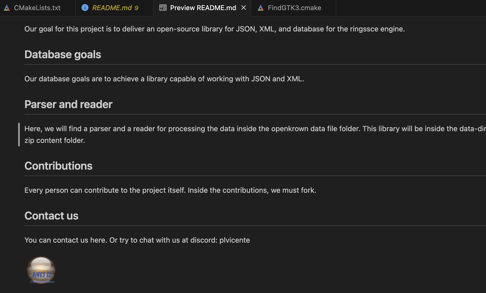

+++
title = "Markdown vs code"
date = 2023-11-18T16:15:20Z
lastmod = 2023-11-18T16:15:20Z
author = "Kayte Studio"
categories = ["macOS"]
tags = ["codermag archive"]
originalUrl = "https://codermag.gleentech.com/2023/11/18/markdown-vs-code/"
+++

Hello readers,

Today, we are going to learn how to preview a markdown file with preview on vs code.

``` wp-block-code

#  ringsce editor
This is an editor written with Lazarus IDE and free Pascal. Where you can use for ringsce repo to build the engine

## Our Goals
Our goal for this project is to deliver an open-source library for JSON, XML, and database for the ringssce engine.

## Database goals

Our database goals are to achieve a library capable of working with JSON and XML.

## Parser and reader
Here, we will find a parser and a reader for processing the data inside the openkrown data file folder. This library will be inside the data-dir folder. With this parser, we can manipulate the data from the zip content folder.

## Contributions
Every person can contribute to the project itself. Inside the contributions, we must fork.

## Contact us
You can contact us here. Or try to chat with us at discord: plvicente


```

``` wp-block-code
cmd + shift + v
```


