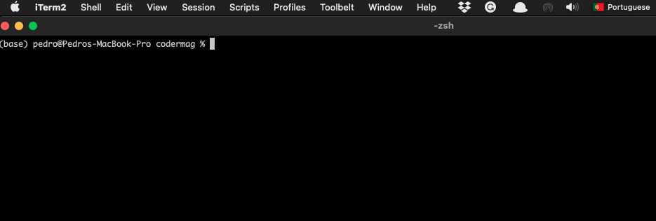
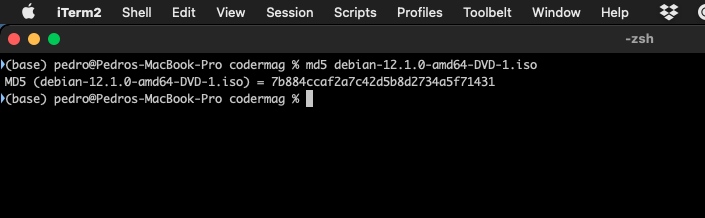
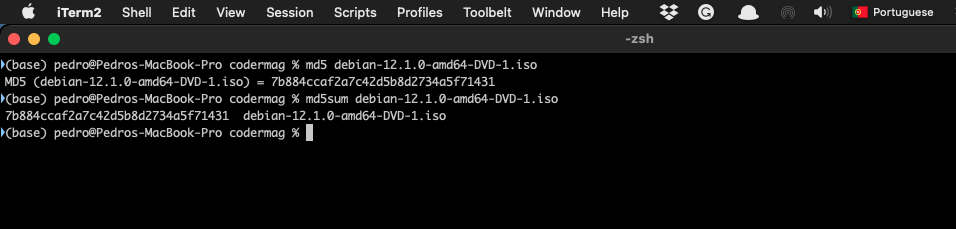

+++
title = "md5 on macos"
date = 2023-11-10T14:24:20Z
lastmod = 2023-11-10T14:24:21Z
author = "Kayte Studio"
categories = ["macOS"]
tags = ["codermag archive"]
originalUrl = "https://codermag.gleentech.com/2023/11/10/md5-on-macos/"
+++

Today, we are going to learn how to use md5 on our own terminal.

First call the terminal:



Then type md5:

``` bash
md5 debian-12.1.0-amd64-DVD-1.iso
```



Now, finally md5sum:


