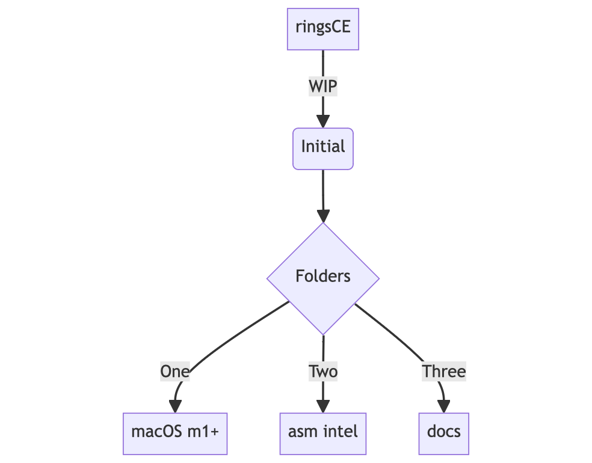
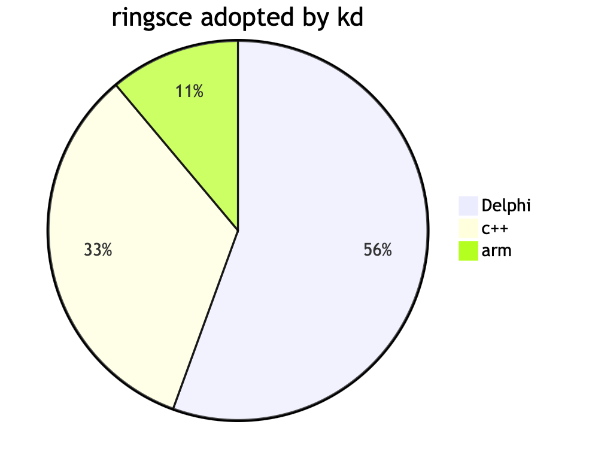

+++
title = "mermaid.js pie and chart"
date = 2024-02-08T08:59:06Z
lastmod = 2024-02-08T08:59:06Z
author = "Kayte Studio"
categories = ["macOS"]
tags = ["codermag archive"]
originalUrl = "https://codermag.gleentech.com/2024/02/08/mermaid-js-pie-and-chart/"
+++

Hello readers,

Today we are going to learn how to use mermaid.js for pie and chart graphics with markdown pages.

``` text
flowchart TD
    A[ringsCE] -->|WIP| B(Initial)
    B --> C{Folders}
    C -->|One| D[macOS m1+]
    C -->|Two| E[asm intel ]
    C -->|Three| F[docs]
```



``` text
pie title ringsce adopted by kd
    "arm": 10
    "c++": 30
    "Delphi": 50
```



Next week, we are going to learn how to use them, with my gatsby docs.gleentech.com repo for ringsce Engine and Ekron MMO.
