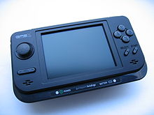
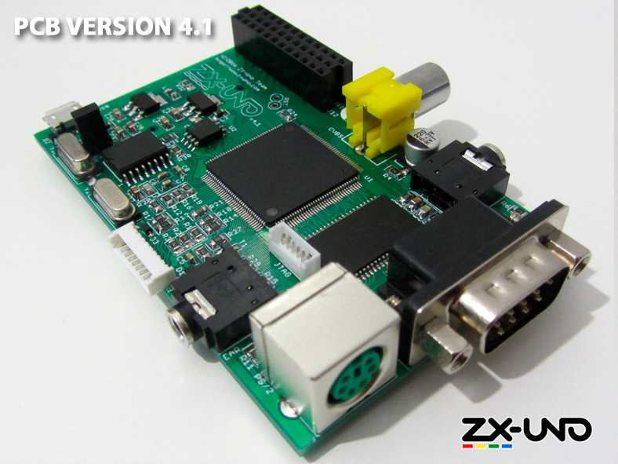
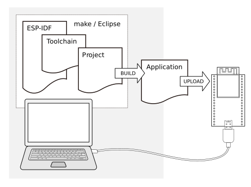
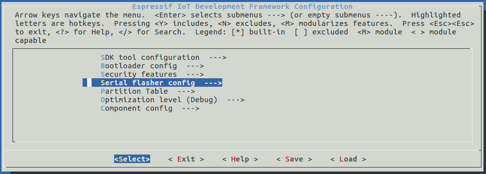

+++
title = "Odroid ESP Idf – Part 1"
date = 2019-09-27T09:50:17Z
lastmod = 2019-09-27T09:50:17Z
author = "Kayte Studio"
categories = []
tags = ["codermag archive"]
originalUrl = "https://codermag.gleentech.com/2019/09/27/odroid-esp-idf-part-1/"
+++


Hello everyone, today's I am going to talk about how to setup an Odroid Go with the toolchain ESP IDF.

Also have a gp2x and an zx-uno

- 
- 

## What You Need

Hardware:

- An **ESP32** board
- **USB cable** - USB A / micro USB B
- **Computer** running Windows, Linux, or macOS

Software:

- **Toolchain** to compile code for ESP32
- **Build tools** - CMake and Ninja to build a full **Application** for ESP32
- **ESP-IDF** that essentially contains API (software libraries and source code) for ESP32 and scripts to operate the **Toolchain**
- **Text editor** to write programs (**Projects**) in C, e.g., [Eclipse](https://www.eclipse.org/)



Linux & MacOS

``` bash
cd ~/esp
git clone --recursive https://github.com/espressif/esp-idf.git
```

``` bash
cd ~/esp/esp-idf
./install.sh
. $HOME/esp/esp-idf/export.sh
```

Start a project for esp32

``` bash
cd ~/esp
cp -r $IDF_PATH/examples/get-started/hello_world .
```

Connectivity:

Serial ports have the following patterns in their names:

- **Windows**: names like `COM1`
- **Linux**: starting with `/dev/tty`
- **macOS**: starting with `/dev/cu.`

Linux & MacOS:

``` bash
cd ~/esp/hello_world
idf.py menuconfig
```



Build:

``` bash
idf.py build
```

In the next parts of the tutorial I will explain how to code c in eclipse or arduino IDE, even the micropython.

Thank you.
