+++
title = "Parallels Debian"
date = 2022-06-04T13:51:10Z
lastmod = 2022-06-04T13:51:10Z
author = "Kayte Studio"
categories = ["Unix / Linux"]
tags = ["codermag archive"]
originalUrl = "https://codermag.gleentech.com/2022/06/04/parallels-debian/"
+++

Today, we will learn how to install Debian on Parallels.

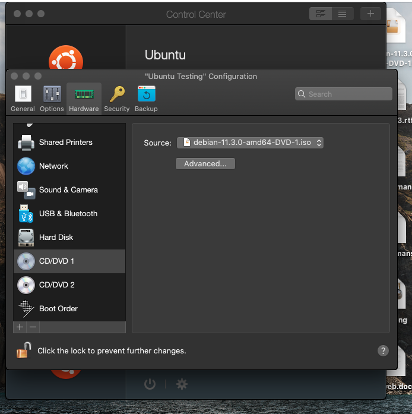 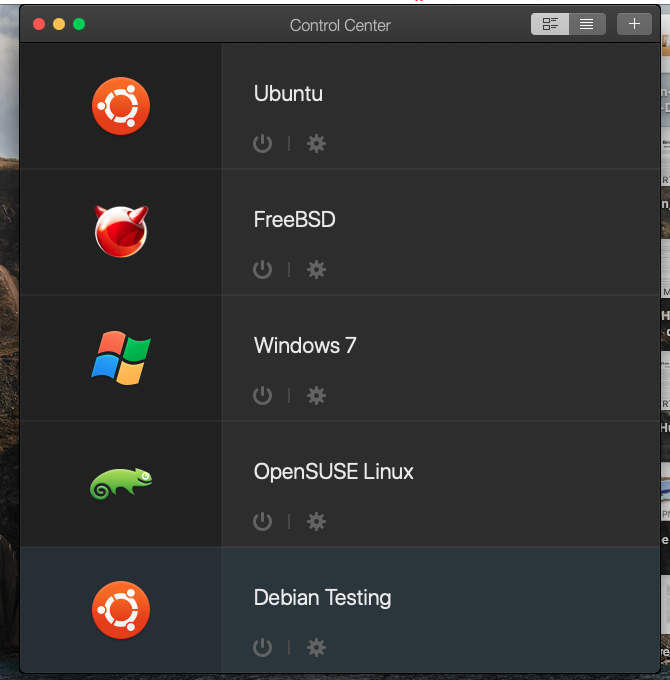 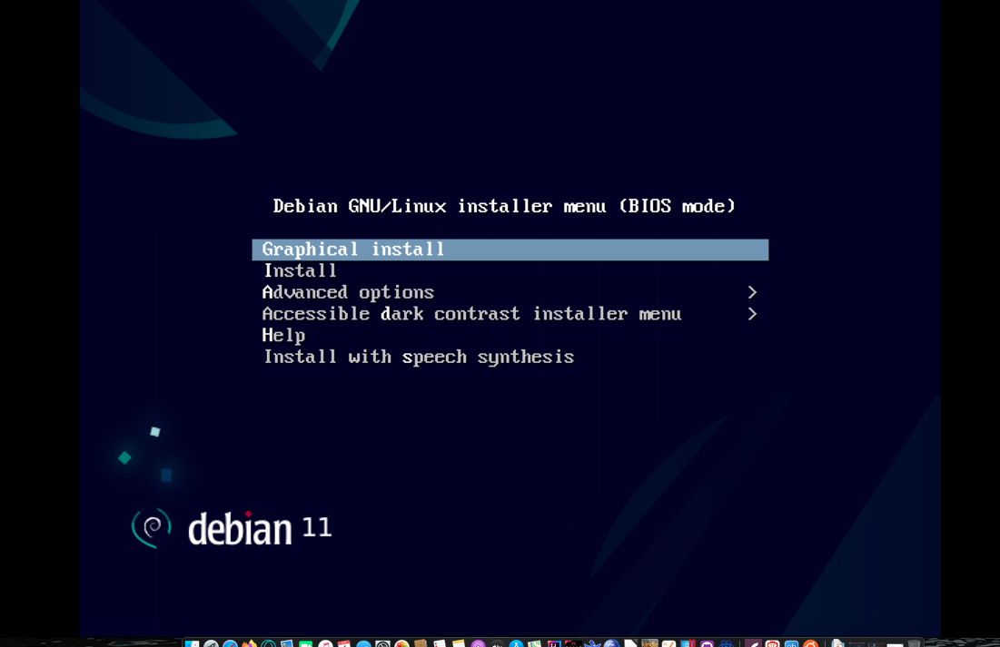 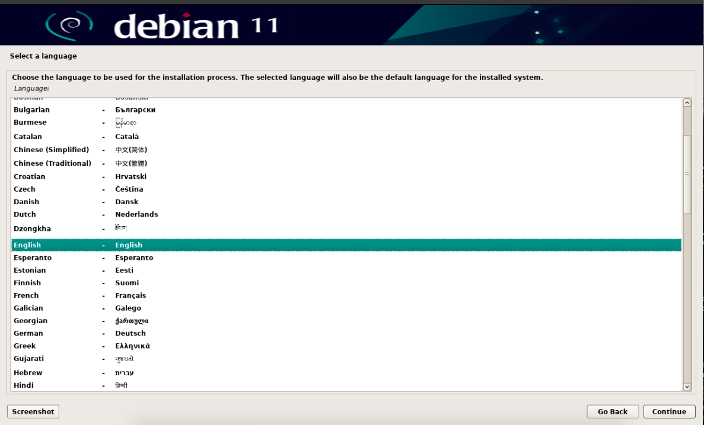 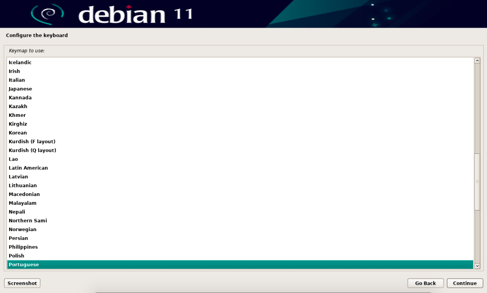 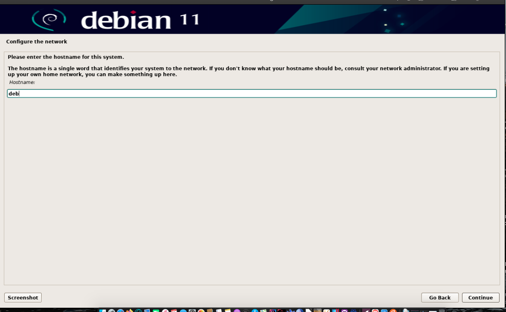 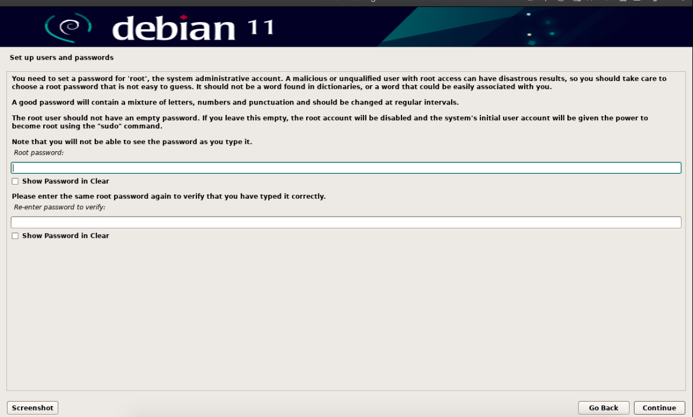 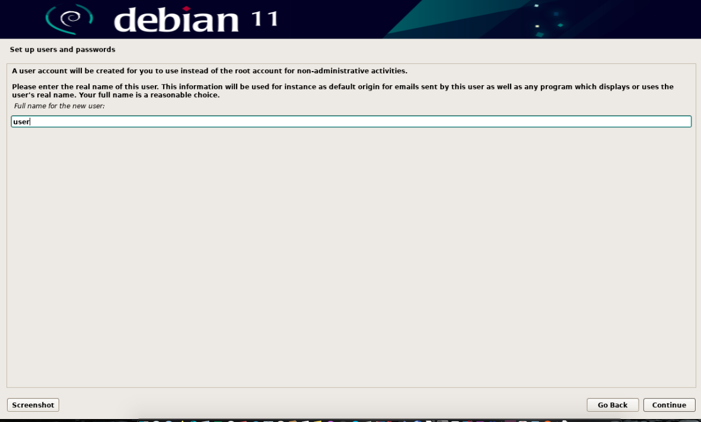 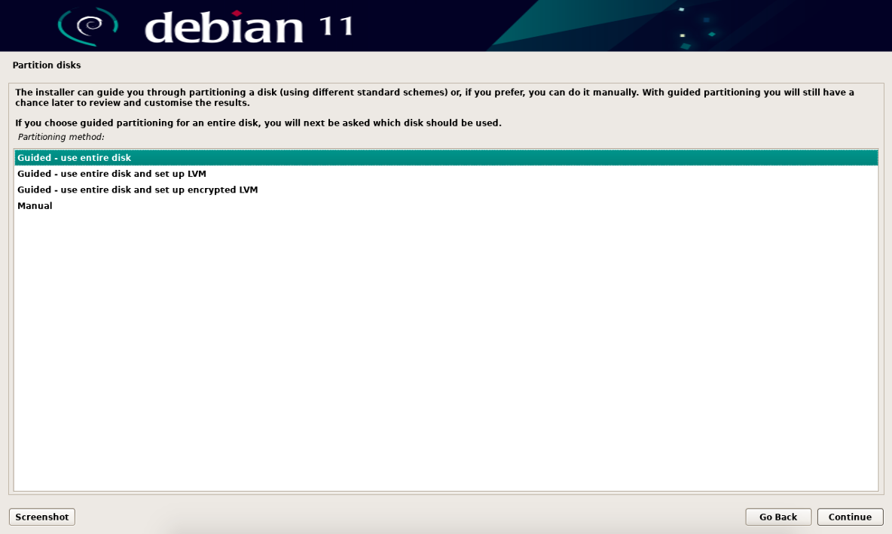 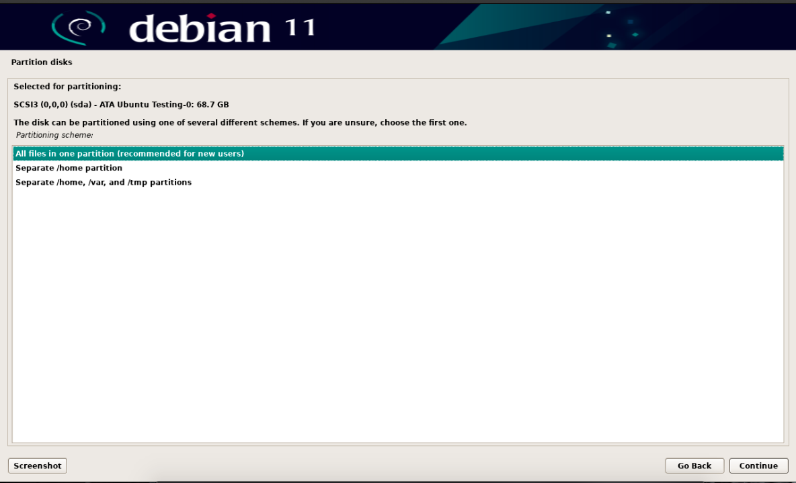 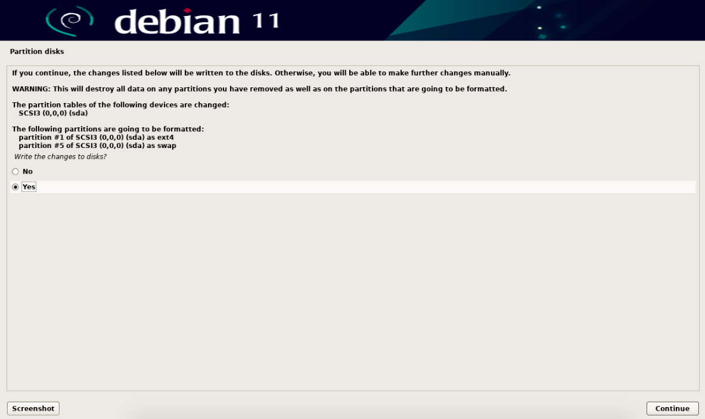 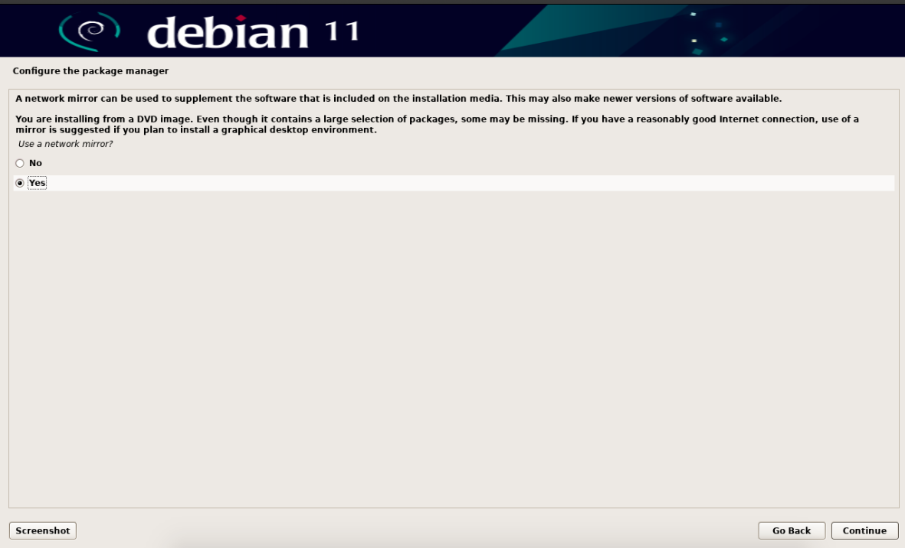 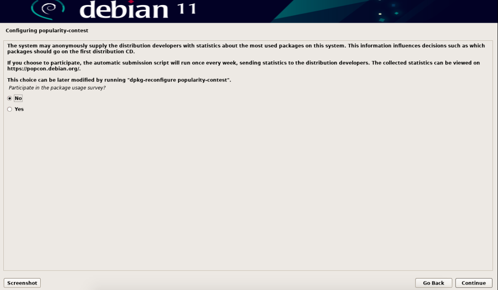 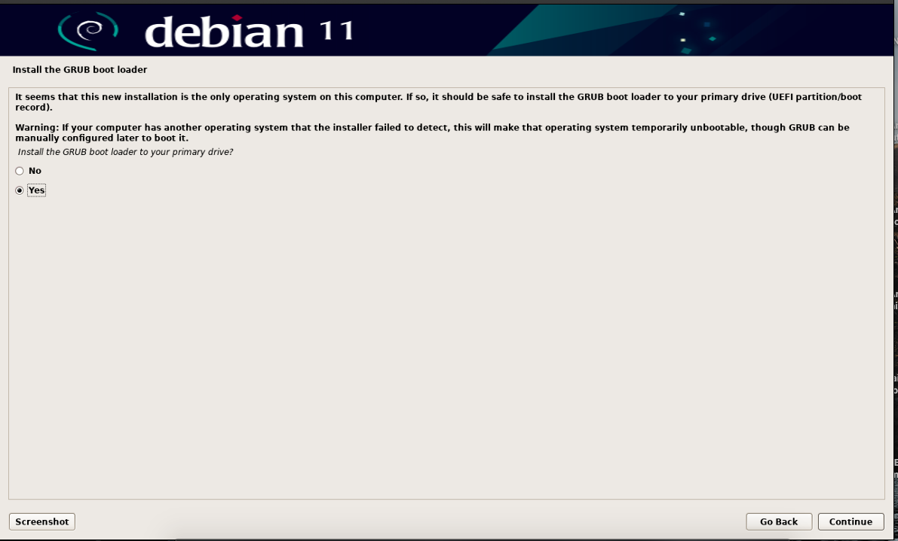  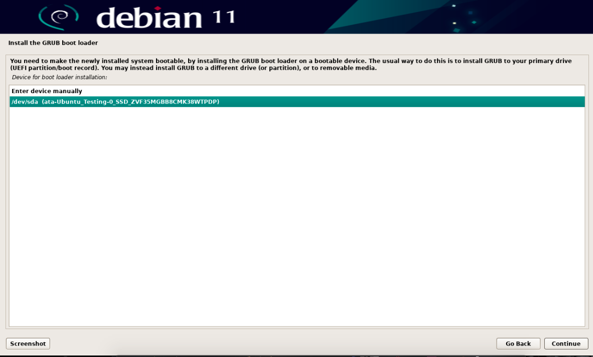 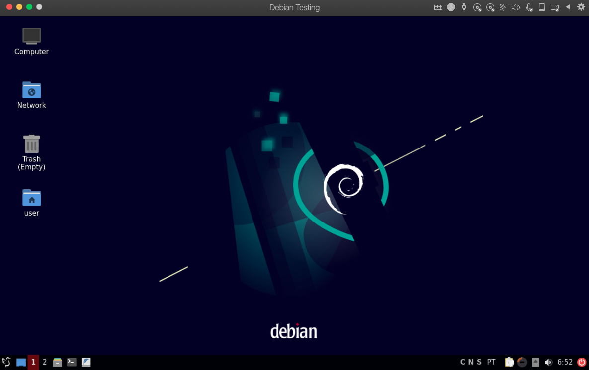

If you follow the screenshots carefully you can have a VM with 8GB Ram and 64GB trim SSD.
