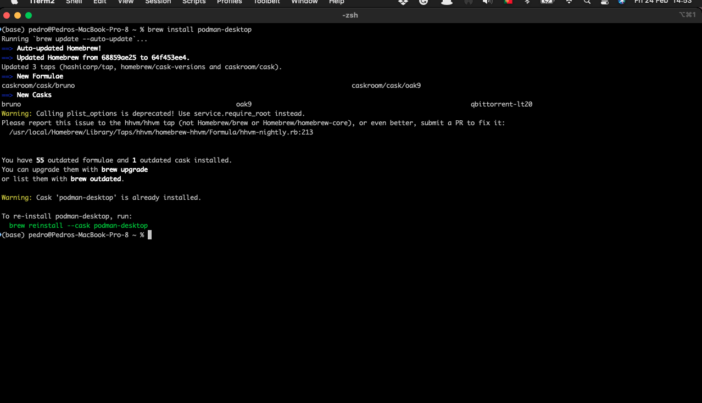
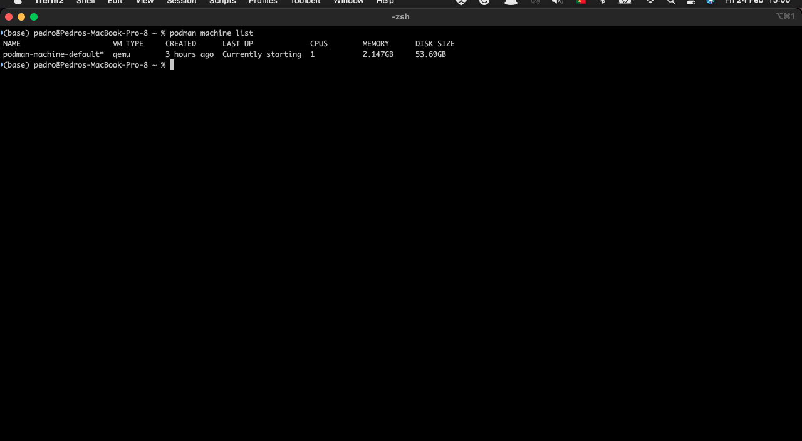
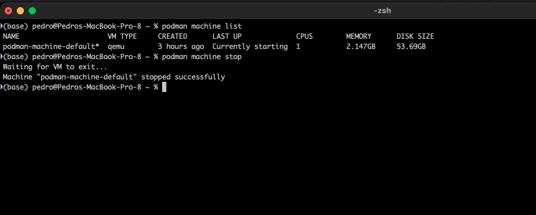
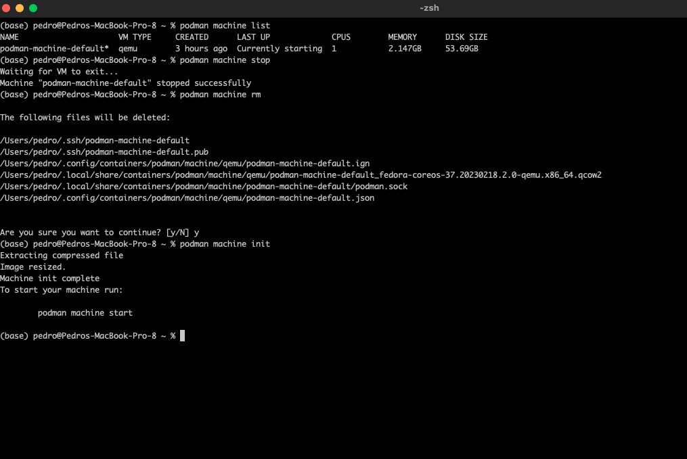
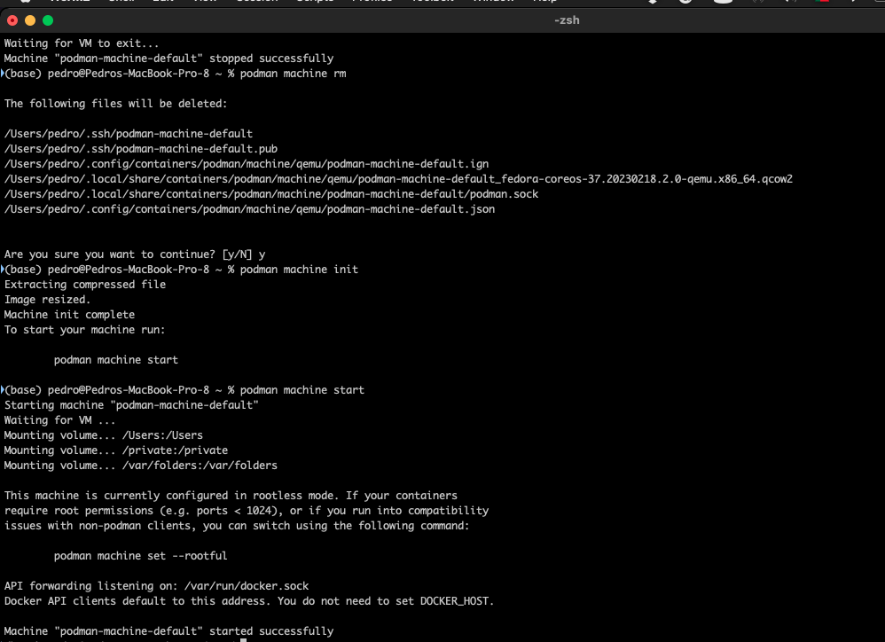
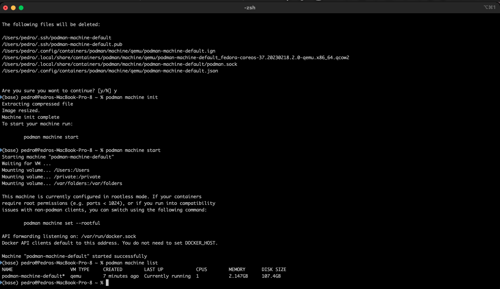

+++
title = "podman instalación"
date = 2023-05-23T08:19:09Z
lastmod = 2023-05-23T08:19:09Z
author = "Kayte Studio"
categories = ["macOS"]
tags = ["codermag archive"]
originalUrl = "https://codermag.gleentech.com/2023/05/23/podman-instalacion/"
+++


Bienvenidos al primero artículo del mes de coder by gleentech Labs.

Aquí la búsqueda de podman en macos ordenadora.

``` bash
brew install podman-desktop
```



Cómo ha visto están en macos. Tiempo a tiempo necesitamos de hacer "upgrade" el brew.

Ahora, la tarea es crear una imagen en podman.



Este comando en tu terminal tiene una lista de ordenadores virtuales.

``` bash
podman machine list
podman machine stop
```



``` bash
podman machine rm
podman machine init
```



``` bash
podman machine start
```

 
