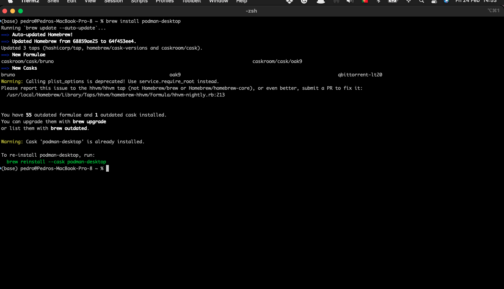
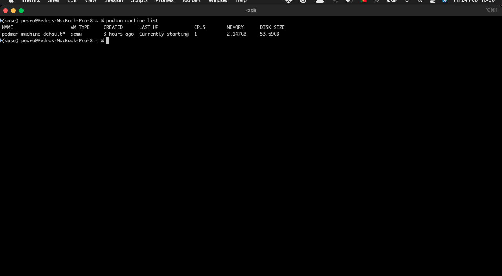
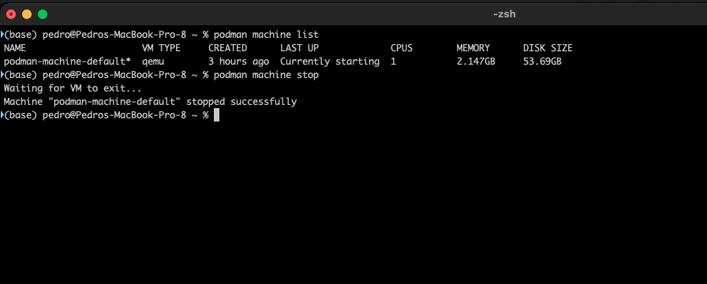
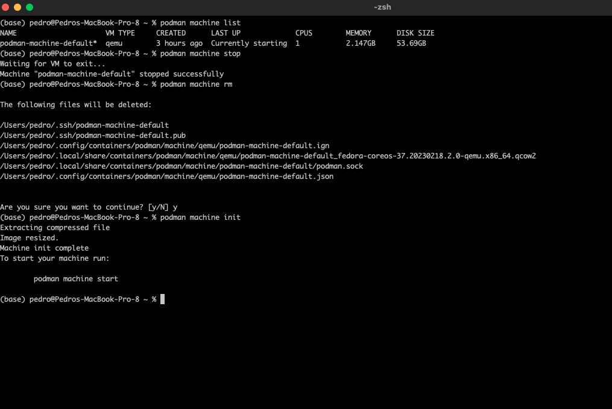
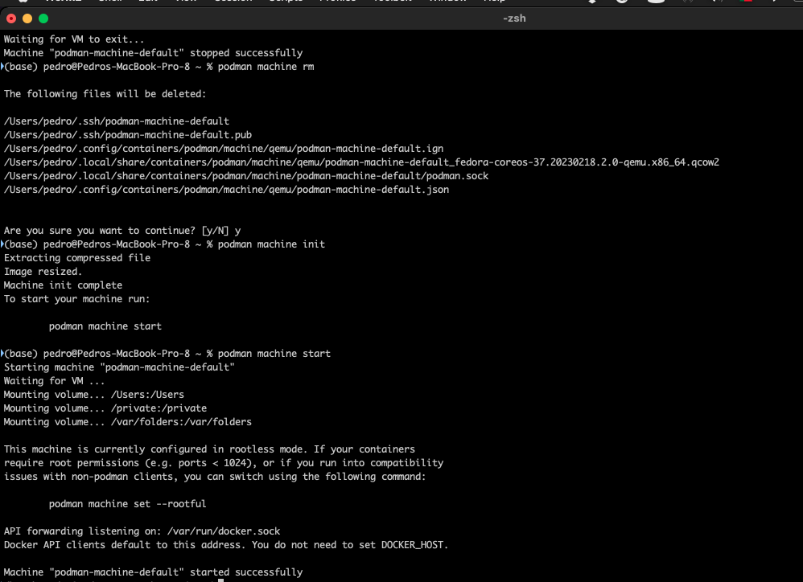
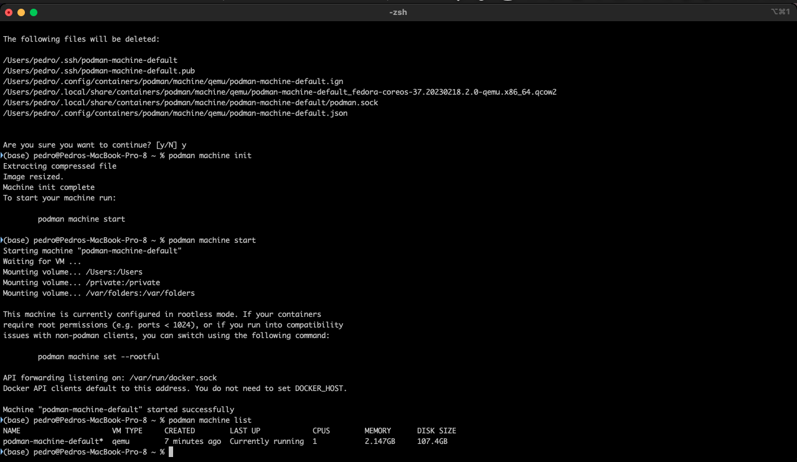

+++
title = "podman installation"
date = 2023-02-24T15:15:36Z
lastmod = 2023-02-24T15:15:36Z
author = "Kayte Studio"
categories = ["Labs", "macOS"]
tags = ["codermag archive"]
originalUrl = "https://codermag.gleentech.com/2023/02/24/podman-installation/"
+++


Welcome to the first article of the month on the coder by gleentech Labs. We are going to learn how to install podman on a macOS machine. We are going to try to make the task easier.

``` bash
brew install podman-desktop
```



As we see, it's already installed. Time a time we should update brew.

Now, we have the podman installed. We are going to see how to create an image to run on podman.



This command is to list the machines active. Now, we are going to delete this image to be prepared for our labs monthly.

``` bash
podman machine list
podman machine stop
```



``` bash
podman machine rm
podman machine init
```



``` bash
podman machine start
```

 
