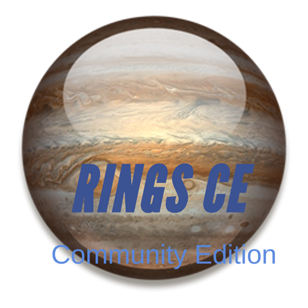

+++
title = "ringsCE 0.2"
date = 2024-01-23T10:48:23Z
lastmod = 2024-01-23T10:48:35Z
author = "Kayte Studio"
categories = ["Alpha"]
tags = ["ringsCE archive"]
originalUrl = "https://ringscejs.gleentech.com/2024/01/23/ringsce-0-2/"
+++

Hello,

ringsCE has been rolled out for 0.2 version. This version will be implemented until July, where we are going to release the major version 0.5. With this version you can implement for now a launcher, an editor for Pascal, C++, with almost syntax.



``` text
git clone --recursive https://github.com/ringsce/west
```

With this roll out you can see a new project as guideline called movement desktop project.

We are delivering a digital platform for macOS, Linux for now. We are working on an iOS and android application to read the feed.

``` text
git clone https://github.com/ringsce/movement-desktop.git
```

With this movement desktop platform, you are able to implement icons on your applications form.
