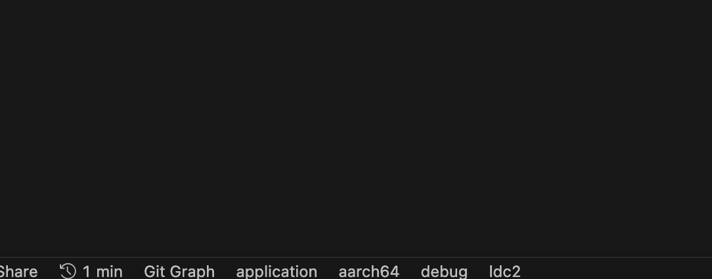

+++
title = "ringsCE #4"
date = 2024-06-12T09:45:51Z
lastmod = 2024-06-12T09:45:59Z
author = "Kayte Studio"
categories = ["macOS"]
tags = ["codermag archive"]
originalUrl = "https://codermag.gleentech.com/2024/06/12/ringsce-4/"
+++

Hello readers,

Today, we are going to learn how to use VSCode with D. We are going to see how to use libraries and its symlinks for VSCode under macOS.

### Welcome to ringsCE

At ringsCE, we are at the forefront of innovation in the gaming and development world, bringing together the power of C and D languages to create robust and efficient solutions. Our mission is to deliver exceptional products and services that cater to the diverse needs of developers and gamers alike.

### The Convergence of C and D Languages

The C language, known for its performance and control, has been a staple in the development community for decades. D, on the other hand, is a modern language that builds upon C's strengths while introducing advanced features such as garbage collection, concurrency, and a powerful type system. At ringsCE, we harness the synergy of C and D to develop solutions that are both high-performing and easy to maintain.

### Cutting-Edge Frontend Development with vibe.d

To enhance our offerings, we utilize **vibe.d**, a high-performance web framework for the D language. With vibe.d, we deliver sophisticated frontend applications for ringsCE cloud services, ensuring a seamless and responsive user experience. This combination allows us to create dynamic, scalable, and secure web applications that meet the highest standards of modern development.

### Our Services

#### Games

Discover a wide array of games across various genres and platforms, curated to provide the best gaming experience.

#### Development Solutions

Leverage our expertise in C and D languages to access:

- **Custom Development**: Tailored solutions to meet your specific needs.
- **Pre-built Modules**: Ready-to-use code components for faster project delivery.
- **Consulting Services**: Professional guidance to optimize your development process.

In order to streamline your development workflow and ensure that you have easy access to essential tools, you can create symbolic links for the LDC compiler and DUB, the D language's package manager, directly in your system’s local bin directory. This enables you to invoke these tools from anywhere in your terminal without needing to specify their full paths.

### Setting Up Symbolic Links

To set up the symbolic links for the LDC compiler and DUB, you will use the following commands:

1.  **Linking the LDC Compiler**:

    ``` bash
    sudo ln -f -s /path/to/ldc/compiler/bin/ldc2 /usr/local/bin/ldc2
    ```

    This command creates a symbolic link for the `ldc2` compiler, making it accessible system-wide as `ldc2`. The `-f` option forces the link creation by removing any existing destination file, and the `-s` option indicates that a symbolic link should be created.

2.  **Linking DUB**:

    ``` bash
    sudo ln -f -s /path/to/ldc/compiler/bin/dub /usr/local/bin/dub
    ```

    Similarly, this command creates a symbolic link for `dub`, enabling you to run it from any directory with ease. Just like the previous command, the `-f` option forces the link creation, and the `-s` option specifies that it should be a symbolic link.

### Benefits

By executing these commands, you ensure that both `ldc2` and `dub` are readily available from the command line, simplifying the development process. This setup is particularly useful for projects that involve frequent compilation and package management tasks, allowing for more efficient and organized development.

Execute these commands in your terminal to streamline your D language development environment:

``` bash
sudo ln -f -s /path/to/ldc/compiler/bin/ldc2 /usr/local/bin/ldc2
sudo ln -f -s /path/to/ldc/compiler/bin/dub /usr/local/bin/dub
```

With these symbolic links in place, you can leverage the full power of the LDC compiler and DUB package manager, enhancing your productivity and ease of use.

 

------------------------------------------------------------------------

As you can see on VSCode for macOS. We are working on a Sonoma m2 MBAir.

------------------------------------------------------------------------

 


