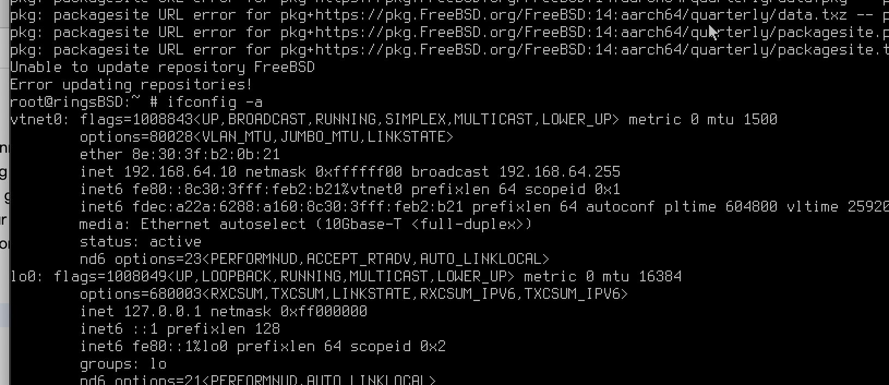
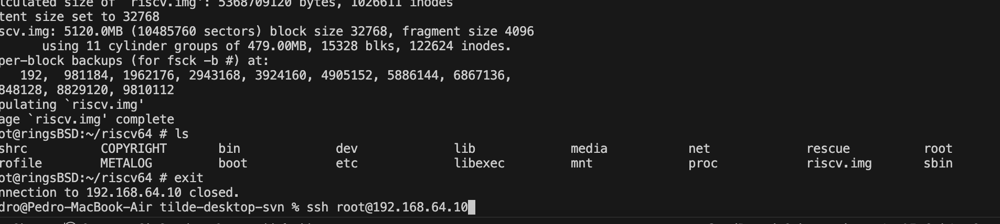
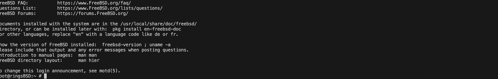

+++
title = "ringsCE #6"
date = 2024-07-11T06:37:49Z
lastmod = 2024-07-11T06:37:49Z
author = "Kayte Studio"
categories = ["macOS"]
tags = ["codermag archive"]
originalUrl = "https://codermag.gleentech.com/2024/07/11/ringsce-6/"
+++

Hello readers,

We are going to learn how to use SSH on a FreeBSD 14.1 ARM64 system running within UTM on macOS Sonoma. Secure Shell (SSH) is a powerful tool for managing and interacting with remote systems securely over a network. By the end of this guide, you'll have a solid understanding of how to set up and use SSH to connect to your FreeBSD virtual machine, enabling you to manage it efficiently from your macOS Sonoma environment. Let's get started!

As you can see you must use:

    ifconfig -a

This will prompt you to an IP address. For me on my network gave this IP address.

Now, we must install sshd:

    pkg install --yes sshd
    sysrc sshd start

    sysrc sshd_enable="YES"
    rc-update add. shhd boot

This must be done as root not user with sudo or sudoers enable.

