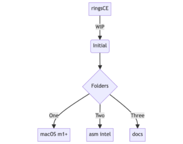

+++
title = "ringsCE changelog #1"
date = 2024-01-30T14:20:53Z
lastmod = 2024-02-01T15:04:38Z
author = "Kayte Studio"
categories = ["Alpha"]
tags = ["ringsCE archive"]
originalUrl = "https://ringscejs.gleentech.com/2024/01/30/ringsce-changelog-1/"
+++

# ringsCE 0.2 changelog

# status:

- launcher
- editor ( syntax highlighting to be done )
- Started syntax
- download manager

All in builtin.

# WIP

- arm switch from x86
- docs is switching from sphinx to mermaid.js
- switch for a new registration site.

Our main goals for now is to deliver a sdk with asm compatible with macOS, a new docs site to become the main docs.\
We are going to keep updated weekly the engine.
