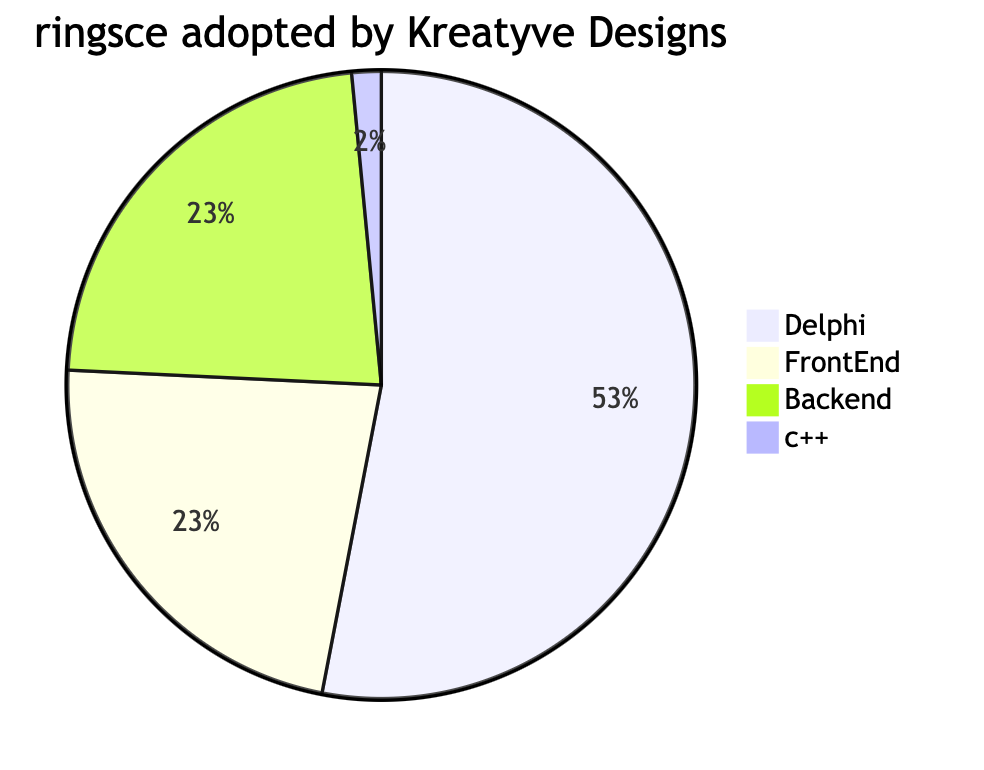
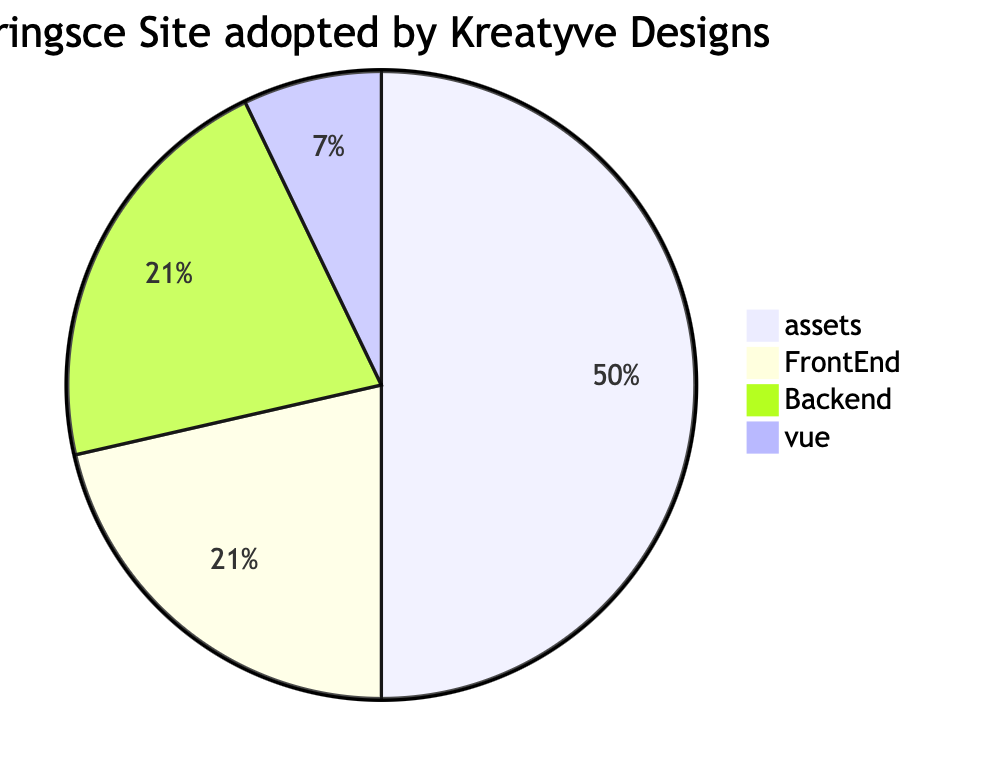

+++
title = "ringsCE engine changes"
date = 2024-02-27T08:21:11Z
lastmod = 2024-02-27T08:22:04Z
author = "Kayte Studio"
categories = ["macOS"]
tags = ["codermag archive"]
originalUrl = "https://codermag.gleentech.com/2024/02/27/ringsce-engine-changes/"
+++

Hello,

We made a few changes, now you can clone the repo for Sites, we are working on a WIP for SaaS with vue, php8 and wordpress plugin.

We are going to see the changes in the few days.



As we all can see the improvements for the engine. The next pie chart you can see the changes on the site SaaS.



``` wp-block-code
git clone --recursive https://github.com/ringsce/west.git
```

With this command you can see the changes we have been working.

Notice: Site is a WIP for now. You must update the Site after we tell.
