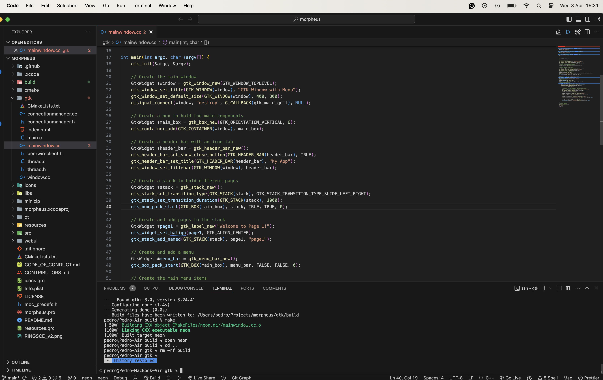
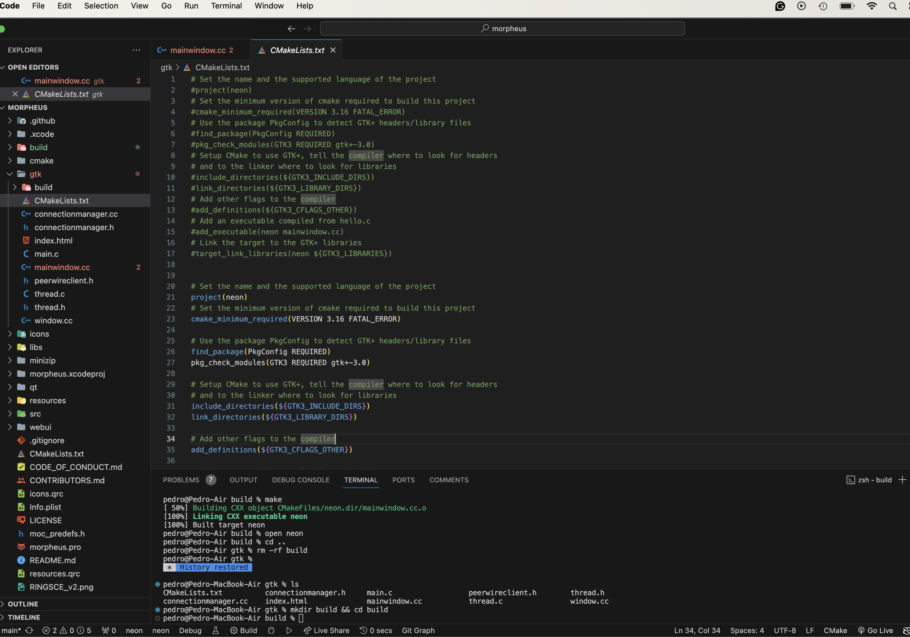
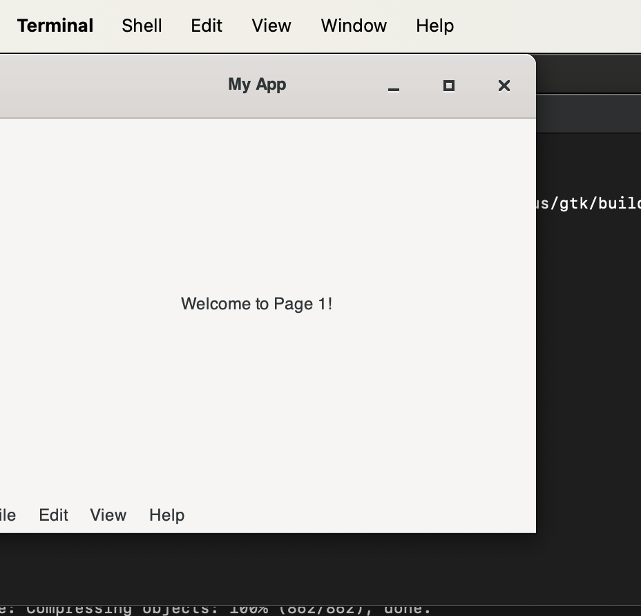

+++
title = "ringsCE morpheus F2F"
date = 2024-04-03T14:37:34Z
lastmod = 2024-04-20T09:43:32Z
author = "Kayte Studio"
categories = ["Labs", "macOS"]
tags = ["codermag archive"]
originalUrl = "https://codermag.gleentech.com/2024/04/03/ringsce-morpheus-f2f/"
+++

Today, we are going to learn how to build the ongoing project morpheus F2F, where you will find an API written in C++. Where you are going to be able to see your documents purchased on ringsce shop.

``` bash
git clone https://github.com/ringsce/morpheus.git
```

Besides being an F2F is an engine to download the assets for Ekron CCG and RPG.

Open the folder on vs code, it's there it is being coded. Today, our focus will be the gtk3 UI.



Now, go to terminal:

``` bash
cd gtk && mkdir build && cd build
cmake ../ && make
```



Then:


