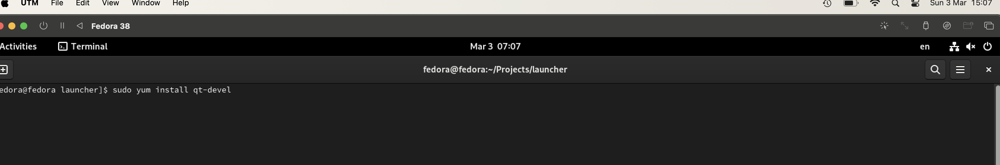
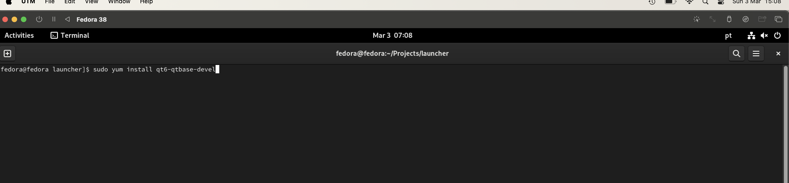
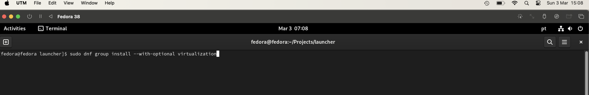
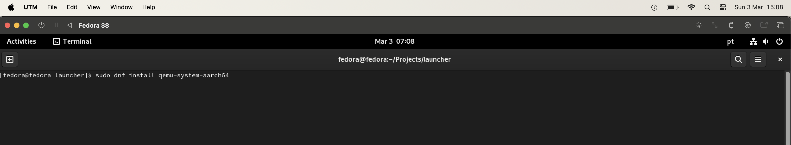
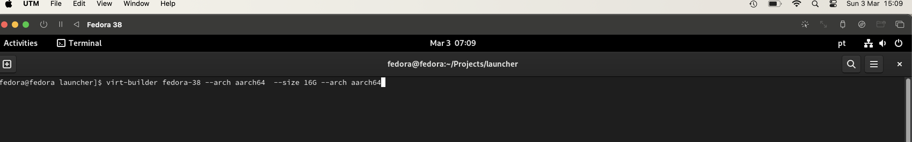

+++
title = "ringsCE phosh status #1"
date = 2024-03-03T15:17:24Z
lastmod = 2024-03-03T15:17:26Z
author = "Kayte Studio"
categories = ["Labs", "macOS"]
tags = ["codermag archive"]
originalUrl = "https://codermag.gleentech.com/2024/03/03/ringsce-phosh-status-1/"
+++

Introduction:

In the dynamic landscape of technology, the convergence of open-source platforms and mobile computing has ushered in a new era of innovation and collaboration. One such convergence is the utilization of the Samsung A13 as the elected device, alongside the Fedora 38 aarch64 image on the MacBook Air M2, to craft images tailored for the Phosh mobile environment. This symbiotic relationship not only underscores the flexibility of open-source software but also exemplifies the cooperative efforts aimed at enhancing user experiences across diverse platforms.

Utilizing the Samsung A13 as the elected device alongside the Fedora 38 aarch64 image on the MacBook Air M2 represents a pivotal step in the creation of optimized images for the Phosh mobile environment. Known for its user-centric design and adaptability, Phosh finds a natural fit on devices powered by the Samsung A13 chipset. By harnessing the capabilities of Fedora 38 and the innovative hardware of the MacBook Air M2, developers can seamlessly craft mobile experiences tailored to the Samsung A13 ecosystem.

Beyond the realm of interface optimization, a broader collaborative initiative is underway to revolutionize the gaming landscape on Samsung A13 devices. Central to this initiative is the development of an open-source gaming platform specifically designed for the Samsung A13 chipset. At its core lies the Samsung A13 gaming ringsce engine, a dynamic framework designed to empower developers and gamers alike.

The Samsung A13 gaming ringsce engine embodies a fusion of cutting-edge technology and community-driven innovation. By embracing open-source principles, developers have created a platform that not only pushes the boundaries of mobile gaming but also fosters inclusivity and collaboration within the gaming community. Thus, the Samsung A13 gaming ringsce engine serves as a testament to the transformative power of open-source development and collective creativity.

In summary, the utilization of the Samsung A13 as the elected device alongside the Fedora 38 aarch64 image on the MacBook Air M2 to build images for the Phosh mobile environment signifies a convergence of innovation and collaboration. Moreover, the development of the Samsung A13 gaming ringsce engine underscores a commitment to redefining the gaming experience on mobile platforms. Together, these initiatives represent the forefront of open-source development, driving forward a future where technology is accessible, inclusive, and empowering for all.

     

Conclusion:

In conclusion, the Phosh mobile environment represents a compelling testament to the power of open-source software and collaborative development efforts. With its user-centric design philosophy and adaptability to diverse hardware platforms like the Samsung A13, Phosh exemplifies the potential for creating seamless and intuitive mobile experiences.

As showcased through the utilization of the Fedora 38 aarch64 image on the MacBook Air M2, alongside the Samsung A13 chipset, Phosh embodies a convergence of innovation and practicality. By harnessing the capabilities of open-source software and leveraging cutting-edge hardware, developers can craft mobile interfaces that prioritize user experience and accessibility.

Furthermore, Phosh's integration into projects such as the Samsung A13 gaming ringsce engine demonstrates its versatility beyond traditional mobile interfaces. Through initiatives like these, Phosh serves as a catalyst for redefining not only how users interact with their devices but also how developers collaborate to push the boundaries of mobile computing.

In essence, Phosh embodies the ethos of open-source development, fostering inclusivity, creativity, and community-driven innovation. As technology continues to evolve, Phosh stands as a beacon of possibility, offering a glimpse into a future where mobile experiences are seamless, personalized, and empowering for all users.
