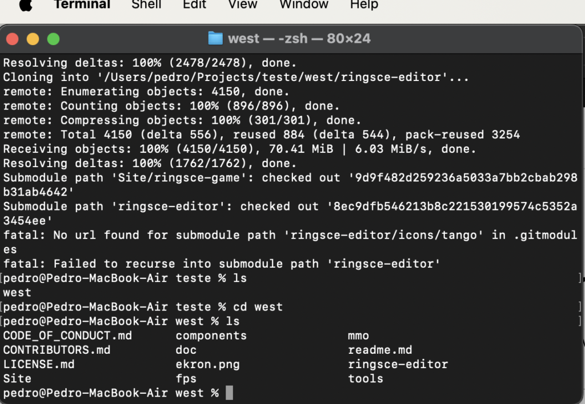

+++
title = "ringsCE status #2"
date = 2024-01-16T11:20:41Z
lastmod = 2024-01-16T11:22:11Z
author = "Kayte Studio"
categories = ["Alpha"]
tags = ["ringsCE archive"]
originalUrl = "https://ringscejs.gleentech.com/2024/01/16/ringsce-status-2/"
+++

Now, we can clone ringsCE with recursive to submodules.

``` text
mkdir test && cd test
git clone --recursive https://github.com/ringsce/west.git
```

Adding sdl2 and tango icons on a submodule git.


