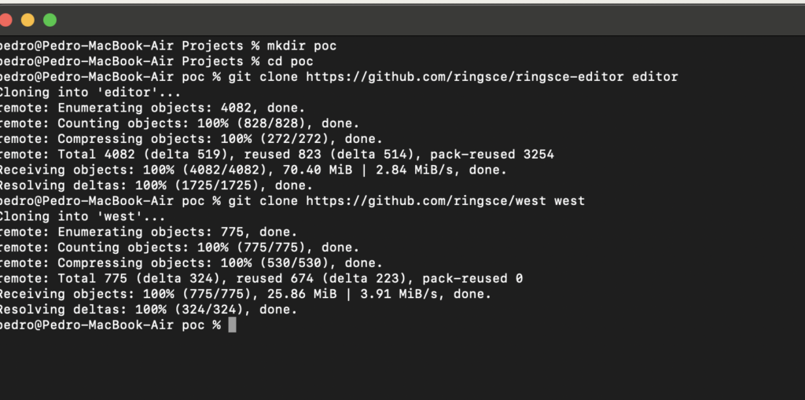
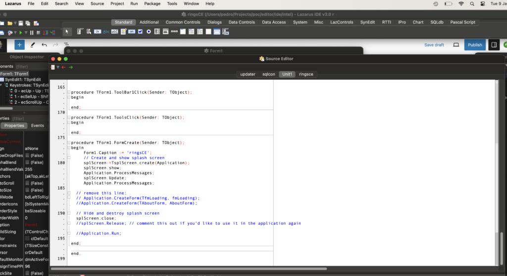
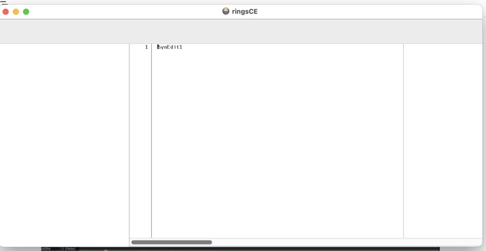
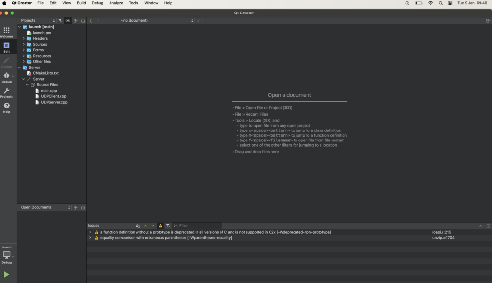
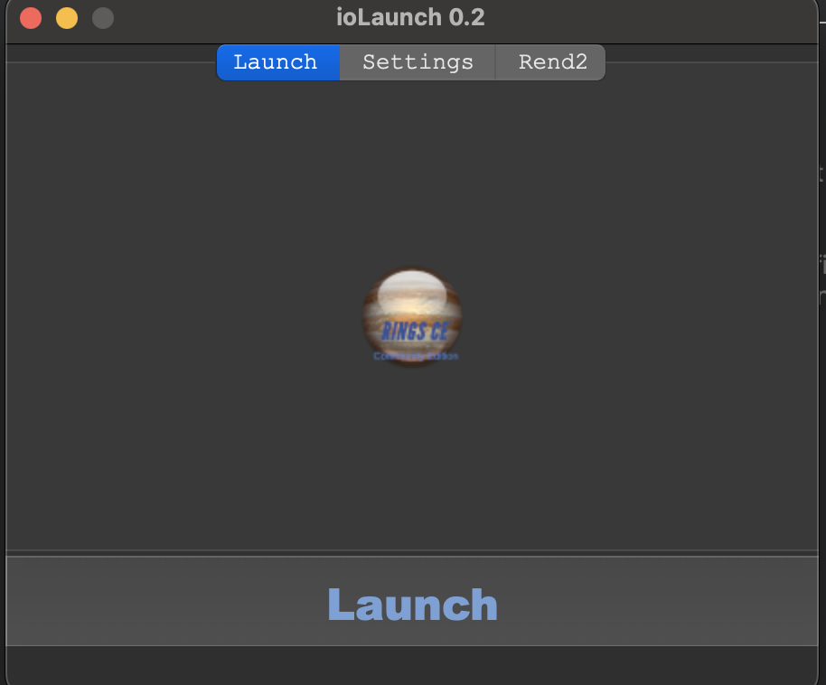

+++
title = "ringsCE status"
date = 2024-01-09T09:49:19Z
lastmod = 2024-01-09T09:49:22Z
author = "Kayte Studio"
categories = ["Alpha"]
tags = ["ringsCE archive"]
originalUrl = "https://ringscejs.gleentech.com/2024/01/09/ringsce-status/"
+++

Hello readers,

Today, we are going to learn how to build the proof of concept of ringsCE framework and its API.

``` text
mkdir poc && cd poc
git clone https://github.com/ringsce-editor editor
git clone https://github.com/west west
```



``` text
cd editor
cd intel
open project1.lpi 
```



``` text
compile
run without debugging 
```



Now, we are going to see how to build a qt6 application for launcher. The CMakeLists.txt is not yet implemented. Next ticket to do.

``` text
cd $USER/Projects/poc/west/tools/launcher
open launch.pro (this will open qt creator on a macOS Sonoma)
```



``` text
build
run
```



We are working on a new alpha called 0.5, where we can see an API demo, a Lua implementation, on 0.6 alpha we will see a UDP Server for MMO and RPG server localhost.
