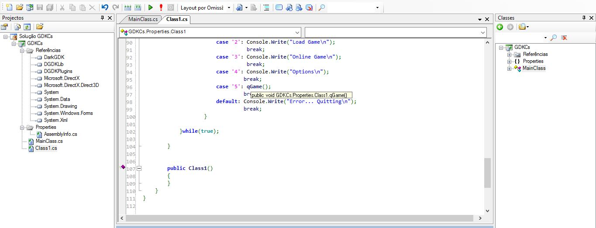
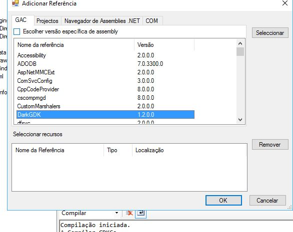

+++
title = "SharpDevelop 3.2+ Dark GDK.net"
date = 2017-02-20T10:53:16Z
lastmod = 2017-02-20T10:53:16Z
author = "Kayte Studio"
categories = ["Posts"]
tags = ["codermag archive"]
originalUrl = "https://codermag.gleentech.com/2017/02/20/sharpdevelop-3-2-dark-gdk-net/"
+++

Hello everyone,

I'm here to tell I was trying to make DLL files for Dark GDK.net and put them on Dark Dasic and Pro version.

I will give here a code snippet for example. BTY I got the project successful. I will give my code template for C# here as a community driven.

The project must be upgraded from 2008. For instance I will show on 2015 Community Edtion too.

Every time everyone needs to create a new code template, you should call references inside c# vesion.

For instance DarkGDK, DGDKLib. You must make to get the code done and built.

I'm here to help. So, any doubt I will try to give an answer soon as possible.

Code Snippet Cllass1.cs:\
/\* Criado por SharpDevelop.\
\* Utilizador: astro\
\* Data: 19/02/2017\
\* Hora: 16:52\
\*\
\* Para alterar este modelo usar Ferramentas \| Opções \| Código \| Alterar Cabeçalhos Standard\
\*/\
using System;

``` csharp
namespace GDKCs.Properties
{
/// <summary>
/// Description of Class1.
/// </summary>
public class Class1
{
//variables
private static Boolean LeftMouseDown;
private static Boolean[] KeyDown = new Boolean[104];
private static int lastScanCode;
public static void SetupKeyEvents() // Must be called once before any of the following functions
{
for (int i = 0; i <= KeyDown.Length; i++)
KeyDown[i] = false;
}
public static Boolean SingleKeyPress(DarkGDK.IO.Keys kKey)
{
if (DarkGDK.IO.Keyboard.State(kKey) && !KeyDown[DarkGDK.IO.Keyboard.ScanCode])
{
KeyDown[DarkGDK.IO.Keyboard.ScanCode] = true;
lastScanCode = DarkGDK.IO.Keyboard.ScanCode;
return true;
}
else if (DarkGDK.IO.Keyboard.ScanCode == 0) // Means we aren't pressing any key 🙂
{
KeyDown[lastScanCode] = false;
return false;
}
else
return false;
}
public static Boolean SingleLeftClick()
{
if (DarkGDK.IO.Mouse.LeftClick && !LeftMouseDown)
{
LeftMouseDown = true;
return true;
}
else if (!DarkGDK.IO.Mouse.LeftClick)
{
LeftMouseDown = false;
return false;
}
return false;
}
public void NGame(){
}
public void LGame()
{
}
public void OGame()
{
}
public void OptGame()
{
}
public void qGame(){
System.Environment.Exit(1);
}
public void Menu()
{
do
{
int c = 1;
switch(c){
case '1': Console.Write("New Game\n");
break;
case '2': Console.Write("Load Game\n");
break;
case '3': Console.Write("Online Game\n");
break;
case '4': Console.Write("Options\n");
break;
case '5': qGame();
break;
default: Console.Write("Error... Quitting\n");
break;
}
}while(true);
}
public Class1()
{
}
}
}
```



T

Thank you so much.
