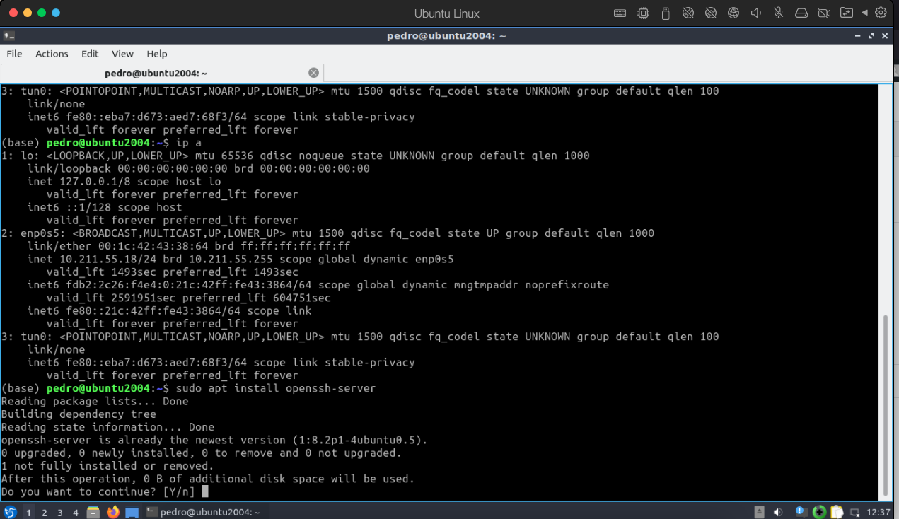
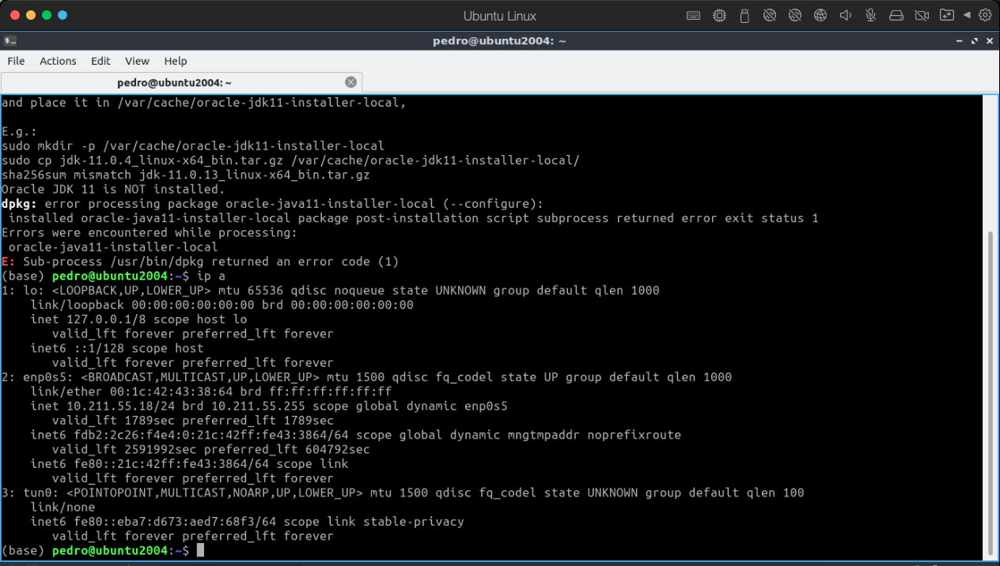
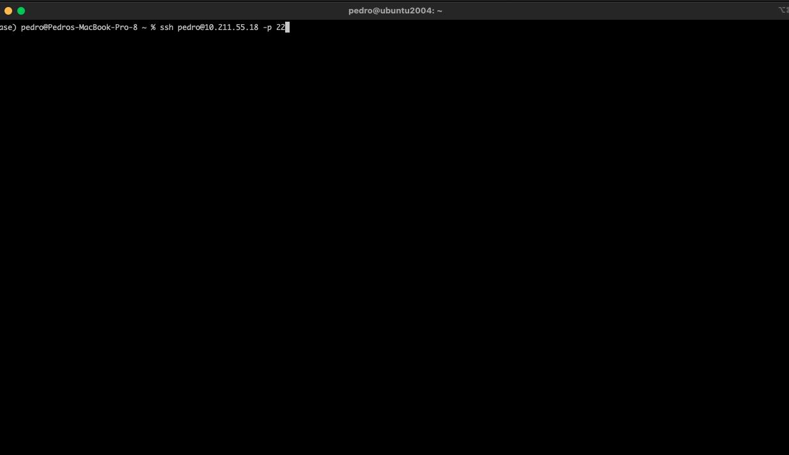
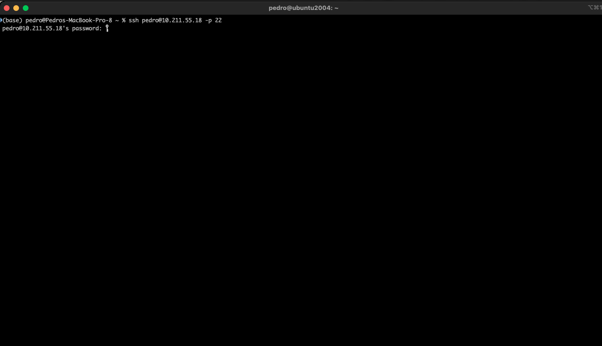
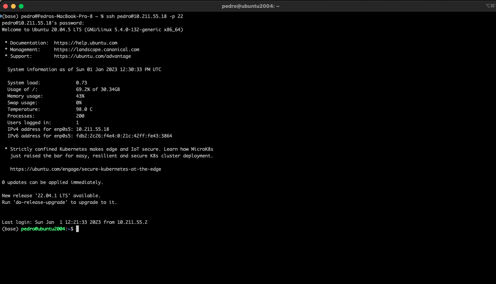

+++
title = "ssh on macOS"
date = 2023-01-01T12:36:11Z
lastmod = 2023-01-01T12:36:11Z
author = "Kayte Studio"
categories = ["macOS"]
tags = ["codermag archive"]
originalUrl = "https://codermag.gleentech.com/2023/01/01/ssh-on-macos/"
+++

Hello readers and followers,

We are going to learn today, how to manage ssh'ing Ubuntu LTS on a macOS environment.

For this purpose, you should install ubuntu on Parallels and openssh-server.

 

  

Remember the IP you enter on the ssh it's shown here with ip a.

The command works like this the ssh

ssh user@ip -p 22

eg: ssh user@10.211.55.18 -p 22

Here we are showing my private IP for the machine.
