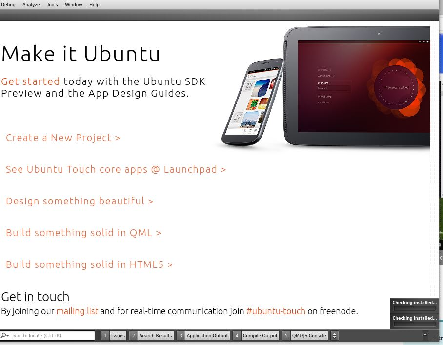

+++
title = "Ubuntu bash on Windows – ubuntu-sdk"
date = 2016-09-13T11:47:27Z
lastmod = 2016-09-13T11:47:27Z
author = "Kayte Studio"
categories = ["Posts"]
tags = ["bash", "ubuntu", "windows", "x11", "codermag archive"]
originalUrl = "https://codermag.gleentech.com/2016/09/13/ubuntu-bash-on-windows-ubuntu-sdk/"
+++

Hi !

 

After install Ubuntu bash on windows, I tried to install ubuntu-sdk.

 

My procedures were apt install update && apt install ubntu-sdk but before that I install from sourceforge xming for windows with shortcuts on the system.

In the end I ran export DISPLAY=localhost:0.0 , ubuntu-sdk & in the bash on windows.

 

You'll see a pic like this one:

 

I will give a tutorial more detailed about this, I wanted to show the ide inside windows 10 x64.

 

Thanx
