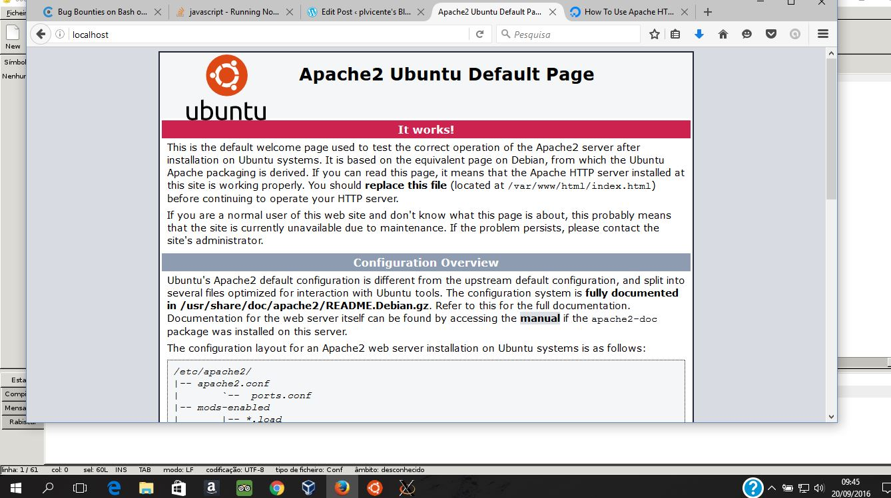

+++
title = "Ubuntu on Windows – apache2 with nodejs"
date = 2016-09-20T09:46:52Z
lastmod = 2016-09-20T09:46:52Z
author = "Kayte Studio"
categories = ["Posts"]
tags = ["codermag archive"]
originalUrl = "https://codermag.gleentech.com/2016/09/20/ubuntu-on-windows-apache2-with-nodejs/"
+++


 

I made a WIP, I wanted to interact apache2 with nodejs.

 

I made a few steps before apache2 configurations.

 

- apt install nodejs-legacy npm apache2
- npm install --upgrade npm
- npm install -g bower grunt express node-php
- service apache2 stop

Then I need to make a personal configuration inside /etc/apache2/sites-enabled/ with the 000-default.conf

Inside this conf file I added with nano /etc/apache2/sites-enabled/000-default.conf

``` lang-js
<VirtualHost *:8080>
    ServerAdmin admin@crawl.com #or your email
    ServerName crawl
    ServerAlias www.crawl.com

    ProxyRequests off

    <Proxy *>
        Order deny,allow
        Allow from all
    </Proxy>

    <Location />
        ProxyPass http://localhost:8000/
        ProxyPassReverse http://localhost:8000/
    </Location>
</VirtualHost>
```

Then I restart the apache2 service through this command: service apache2 restart.

Then I got this configuration working with Bash on Ubuntu on Windows:

 

\<VirtualHost \*:80\>\
\# The ServerName directive sets the request scheme, hostname and port that\
\# the server uses to identify itself. This is used when creating\
\# redirection URLs. In the context of virtual hosts, the ServerName\
\# specifies what hostname must appear in the request's Host: header to\
\# match this virtual host. For the default virtual host (this file) this\
\# value is not decisive as it is used as a last resort host regardless.\
\# However, you must set it for any further virtual host explicitly.\
\#ServerName www.example.com

ServerAdmin webmaster@localhost\
DocumentRoot /var/www/html

\# Available loglevels: trace8, ..., trace1, debug, info, notice, warn,\
\# error, crit, alert, emerg.\
\# It is also possible to configure the loglevel for particular\
\# modules, e.g.\
\#LogLevel info ssl:warn

ErrorLog \${APACHE_LOG_DIR}/error.log\
CustomLog \${APACHE_LOG_DIR}/access.log combined

\# For most configuration files from conf-available/, which are\
\# enabled or disabled at a global level, it is possible to\
\# include a line for only one particular virtual host. For example the\
\# following line enables the CGI configuration for this host only\
\# after it has been globally disabled with "a2disconf".\
\#Include conf-available/serve-cgi-bin.conf

ProxyPreserveHost on

ProxyRequests on

\<Proxy \*\>\
Order deny,allow\
Allow from all

\</Proxy\>\
\#\<Location /\>\
ProxyPass /node http://localhost:8000/\
ProxyPassReverse /node http://localhost:8000/\
\#\</Location\>

ServerName localhost

\</VirtualHost\>\
\# vim: syntax=apache ts=4 sw=4 sts=4 sr noet

But I had issues, fixing them. I couldn't figure out yet which issues are in these configures. Now fixed it I think.

 



Besides it's needed to install XMing for GUI, apt install apache2, libxml2-dev libapr1 libapr1-dev.

 

Thank you. I will keep this updated.

**Error:** Contact form not found.
