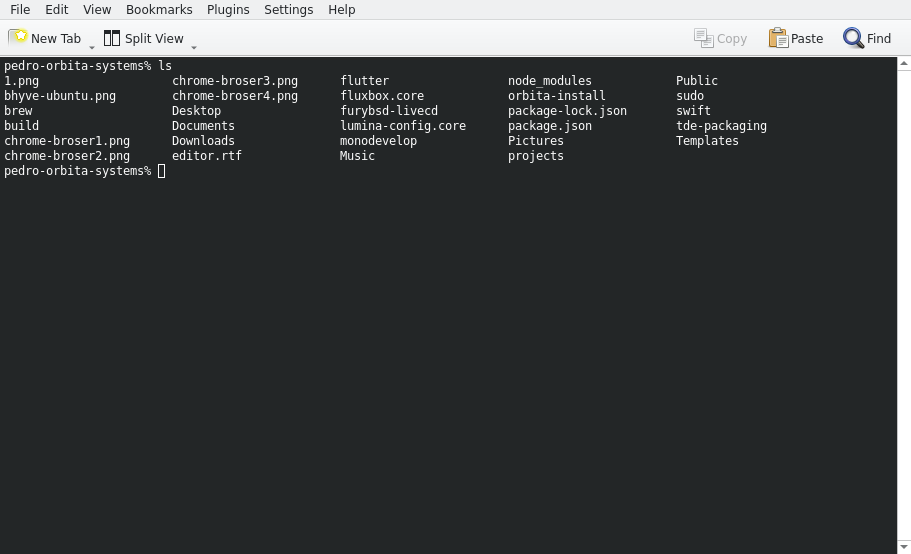
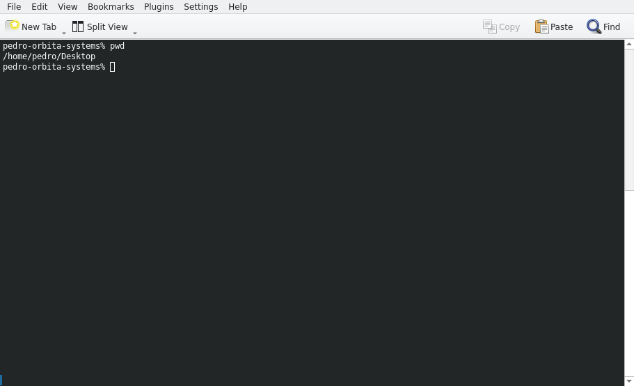

+++
title = "Unix Commands"
date = 2022-05-18T11:23:55Z
lastmod = 2022-05-18T11:23:55Z
author = "Kayte Studio"
categories = []
tags = ["codermag archive"]
originalUrl = "https://codermag.gleentech.com/2022/05/18/unix-commands/"
+++

On this article Coder by Gleentech will teach you how to terminal commands from BSD systems.

Today we saw a growth in Unix and Linux as smartphone, embedded systems. Sometimes we encounter FreeDOS. But nowadays the ecosystem we see is Unix and Linux. Those two systems can be found on iOS and Android systems, besides ChromeOS. In this article, I will teach the basics, the basic

commands to manipulate easily your system.

I will teach how to use list directories, change directories, count words, use grep for debugging, and pipelines. This is an article for introduction is not a hard way article to achieve everything. I want to deliver an easy way to get deep into it. Learning Unix is not an easy task, it takes time. You cannot learn everything in one day about Unix. You need to learn and read tons of papers to have knowledge.

For start, we will go to call the terminal. It’s a command prompt. You must call konsole or terminal application. I am going to have all the examples with konsole.

The first command we see is ls.

As we see we can list a directory.

We see with this command the working directory

