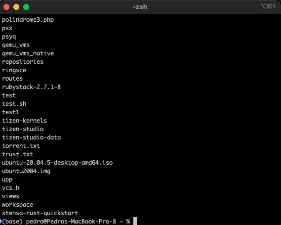
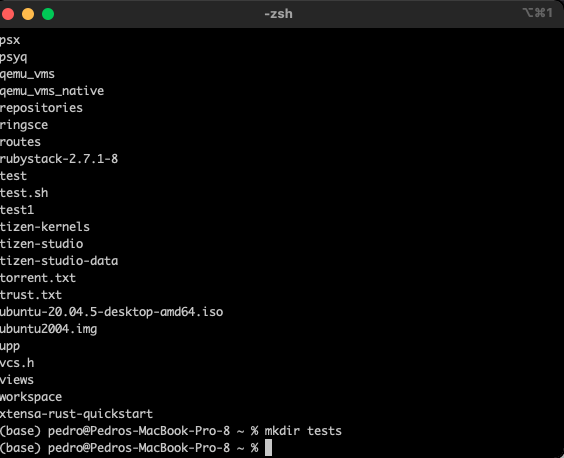
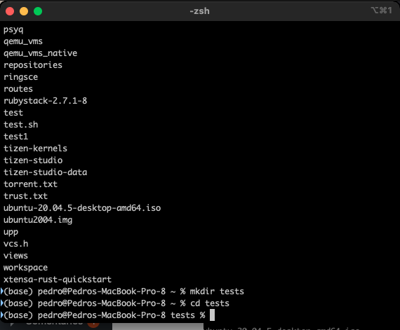
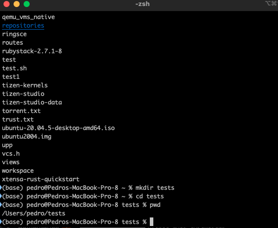

+++
title = "Useful commands for macOS"
date = 2022-12-15T09:37:05Z
lastmod = 2022-12-15T09:37:05Z
author = "Kayte Studio"
categories = ["macOS", "Unix / Linux"]
tags = ["codermag archive"]
originalUrl = "https://codermag.gleentech.com/2022/12/15/useful-commands-for-macos/"
+++

Hello readers and followers at linkedin,

Today, I will show a few useful commands for your zsh terminal. You can test them on iTerm or the terminal itself.

- ls
- when you type ls you can list the folder files even the folders inside of it.
- 

For instance, this command shows my \$HOME directory.

If you are a coder, you can use this helpful command. It's called git. You can install it over brew.

- brew install cmake git
- I have shown cmake because it's helpful for C/C++ projects under macOS.

/bin/bash -c "\$(curl -fsSL https://raw.githubusercontent.com/Homebrew/install/HEAD/install.sh)"

With this command, you can install them on your mac the brew command.

- mkdir command is helpful to create directories.

Now, we are going to see the cd command, this command can be helpful to switch directories.

For last, the pwd command. I will release few articles about commands over here at coder by gleentech.

With this command, you can see the location of the directory, where you are. In this example, you can see /Users/pedro/tests. This directory belongs to my file structure for example.
