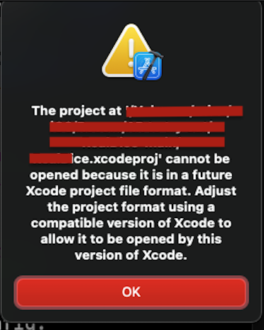

+++
title = "XCode 13 big sur"
date = 2023-10-01T10:37:16Z
lastmod = 2023-10-01T10:37:16Z
author = "Kayte Studio"
categories = ["macOS"]
tags = ["codermag archive"]
originalUrl = "https://codermag.gleentech.com/2023/10/01/xcode-13-big-sur/"
+++

Hola lectores,

Hoy nosotros tenemos en una aplicación esto:



Nuestra aplicación para tenermos actual, nosotros hacemos una modificación.

``` text
objectVersion = 56;
para
objectVersion = 50;
```
