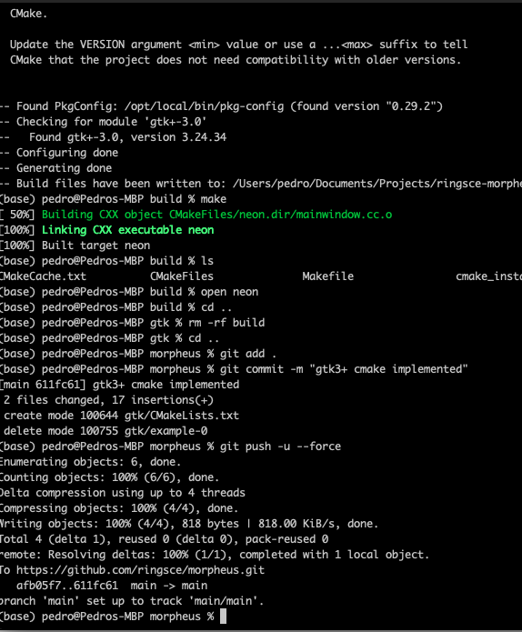
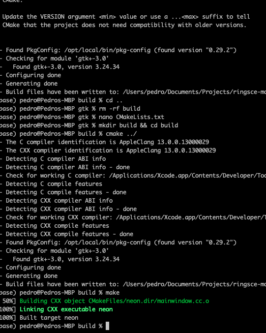
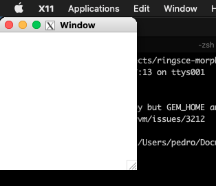

+++
title = "XQuartz con  cmake"
date = 2023-10-10T12:17:46Z
lastmod = 2023-10-10T12:17:46Z
author = "Kayte Studio"
categories = ["macOS"]
tags = ["codermag archive"]
originalUrl = "https://codermag.gleentech.com/2023/10/10/xquartz-con-cmake/"
+++

Hola Lectores,

Hoy, Tenemos una build con gtk3+ y cmake en Big Sur ordenador.

Primero:

``` wp-block-code
git clone https://github.com/ringsce/morpheus
```

Entonces:

``` wp-block-code
cd morpheus && cd gtk
```

Después:



Ahora:

``` wp-block-code
mkdir build && cd build
cmake ../
make
```

Por fin:



``` wp-block-code
open neon
```


