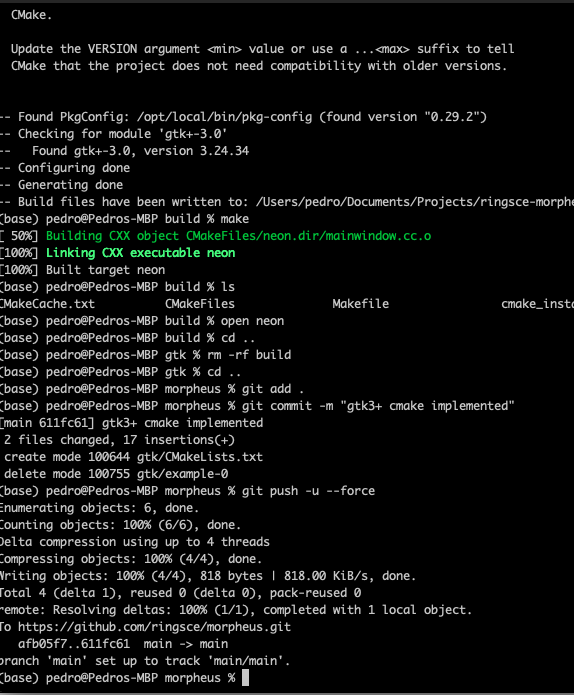
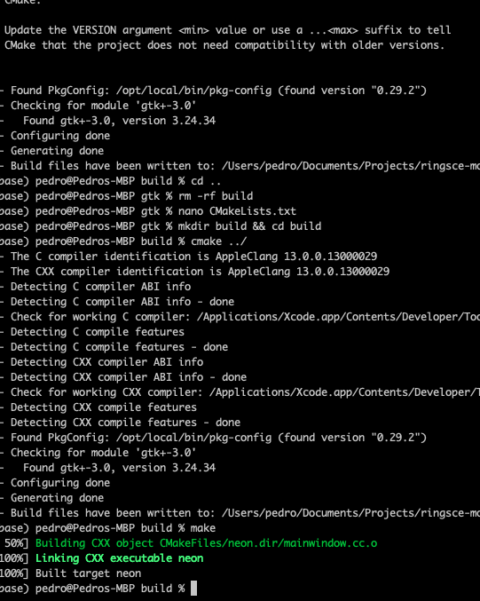
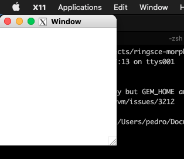

+++
title = "XQuartz with cmake"
date = 2023-10-10T12:14:20Z
lastmod = 2023-10-10T12:14:21Z
author = "Kayte Studio"
categories = ["macOS"]
tags = ["codermag archive"]
originalUrl = "https://codermag.gleentech.com/2023/10/10/xquartz-with-cmake/"
+++

Hello readers,

Today, we are going to learn how to build gtk3+ with cmake on a Big Sur machine.

First:

``` bash
git clone https://github.com/ringsce/morpheus
```

Then:

``` bash
cd morpheus && cd gtk
```

After that:



Now:

``` bash
mkdir build && cd build
cmake ../
make
```

Then at last:



``` bash
open neon
```


